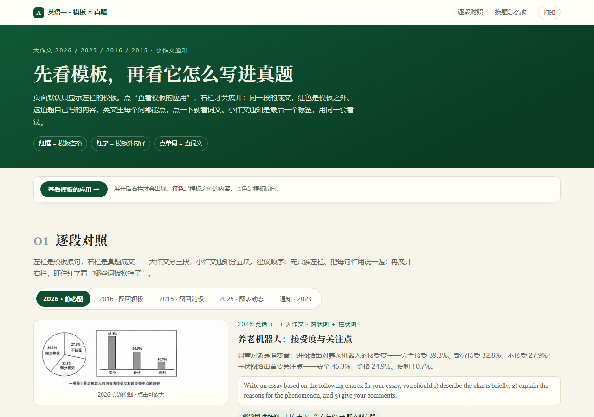

# 英语一 · 作文模板 × 真题对照

一个单文件网页：**左边是模板，右边是真题成文**。红色标出模板之外、这道题自己写的内容；点按钮展开对照，点单词查词义，点图片放大。

**在线打开：<https://pengpoiuyy.github.io/english-essay-guide/>**

## 收录内容

| 标签 | 真题 | 对应模板 |
| --- | --- | --- |
| 2026 · 静态图 | 养老机器人：接受度与关注点（饼图 + 柱状图） | 静态首段 3 句 + 原因段（三选二）+ 结论段（二选一） |
| 2016 · 图画积极 | 树立榜样：家庭教育（两幅对比漫画） | 两图版首段 4 句 + 价值段 5 句 + 结论段 3 句 |
| 2015 · 图画消极 | 手机时代的聚会：手机沉迷（单幅漫画） | 图画首段 4 句 + 原因段 4 句 + 结论段 3 句 |
| 2025 · 图表动态 | 耐用消费品拥有量（表格） | 动态首段 3 句 + 原因段（三选二）+ 结论段（二选一） |
| 通知 · 2023 | 招募 Smith 教授研究项目的学生 | 通知五块：标题日期 / 目的 / 时间地点与要求 / 报名方式 / 署名 |

## 怎么用

1. 打开页面，默认只显示左栏模板（红框就是空格）。
2. 点「查看模板的应用」，右栏展开；**红色**是模板之外的内容，黑色是模板原句。
3. 点任意英文单词，弹出词义；点真题图片可以放大。
4. 顶部标签切换真题，每篇下面都有「换题只改这里」的提示。

## AI 批改（可选）

页面右下角的「✍️ AI 批改」需要一个小后端（放在 `ai-backend/`，零依赖 Node）：

- 按考研英语一考纲评分：A 节 10 分、B 节 20 分，先定五档再给分（B 节档内可调 1–3 分）；
- 评内容要点、组织连贯、语法词汇、格式语域，另查模板句是否套对、填空位是否漏；
- 部署方法见 [ai-backend/README.md](ai-backend/README.md)；
- 部署后把接口地址填进页面「设置」，或写死在 `index.html` 的 `AI_DEFAULT_ENDPOINT`。

## 说明

- 整个页面就是一个 `index.html`：样式、脚本、真题图片全部内嵌，离线双击也能打开。
- 英文按公开真题资料还原，红色标注参考原卷解析；仅供学习使用。
- 想更新内容：改 `index.html` 后提交，GitHub Pages 会自动重新发布，链接不变。

## 本地打开

下载仓库，双击 `index.html` 即可（图片已内嵌，不依赖网络）。
